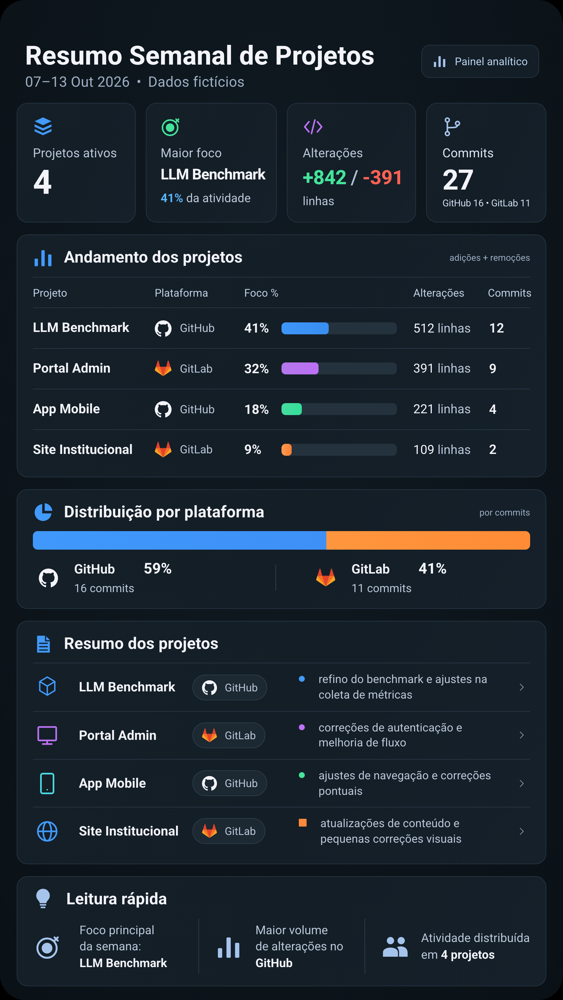

# Weekly Dev Report

Dashboard local para transformar a atividade semanal de desenvolvimento em um relatório visual exportável para PNG. Construído com HTML, CSS e JavaScript, com coleta de GitHub e GitLab por meio dos conectores autenticados do Codex.

A execução principal é **local**: plugins GitHub/GitLab do Codex para coleta, Python para métricas e o Chrome já instalado para PNG. As dependências são preparadas uma vez; a rotina semanal não instala pacotes nem baixa navegadores. A demonstração funciona **sem conta, tokens ou autenticação**.



## Funcionalidades

- Indicadores de projetos ativos, commits e linhas adicionadas/removidas.
- Participação por projeto e distribuição de commits por plataforma.
- Resumos com referências às evidências coletadas.
- Deduplicação por repositório/SHA e filtros para merges, dependências, arquivos gerados e ponteiros de submódulos.
- Sinalização de fontes parciais ou indisponíveis.
- Exportação automática do dashboard completo em PNG, com fontes e ícones locais.

## Tecnologias e requisitos

| Componente | Uso |
| --- | --- |
| HTML, CSS, JavaScript ES Modules | Dashboard sem framework ou etapa de build |
| JSON | Dados e configuração |
| Node.js 20+ e npm | Servidor local e exportação |
| Playwright e Google Chrome instalado | Captura do PNG; Playwright fixado no lockfile |
| Python 3.10+ | Coletor; biblioteca padrão e base de fusos IANA |
| Conectores GitHub/GitLab no Codex | Somente para dados reais |

Os comandos abaixo usam shell POSIX (macOS/Linux; Windows via WSL). A ponte do Codex usa `python3` e comandos POSIX. Nenhum caminho específico de um computador é necessário. Git é opcional para detectar o e-mail local de autoria. Se o Python não encontrar `America/Sao_Paulo`, instale a base IANA do sistema ou `python3 -m pip install tzdata`.

## Instalação e demonstração

Na pasta do projeto extraído ou clonado:

```sh
npm ci
npm start
```

Abra [a prévia local](http://127.0.0.1:4173). O dashboard carrega `data/demo.json`. Use HTTP: abrir o HTML diretamente com `file://` não carrega os módulos e o JSON corretamente.

Instale o Google Chrome previamente. O exportador usa `--channel chrome` por padrão e falha com uma mensagem se o navegador não estiver disponível. Ele nunca instala um navegador automaticamente.

Opcionalmente, para usar o Chromium vinculado ao Playwright, instale-o **uma vez** com `npx playwright install --only-shell chromium` e execute a exportação com `--channel chromium`. Em Linux, a instalação inicial pode exigir bibliotecas do sistema.

## Gerar e exportar manualmente

```sh
npm run export
```

O resultado fica em `reports/weekly-dev-report.png`. O exportador abre e encerra seu próprio servidor; não depende de `npm start`.

```sh
npm run export -- --input data/demo.json --output reports/minha-semana.png --scale 2
```

Escalas: 1, 2 (padrão) ou 3. A demonstração em escala 2 mede 1.884 × 3.344 px; a altura cresce conforme o conteúdo. O padrão usa o Chrome instalado. A rasterização pode variar quando o Chrome é atualizado; se precisar fixar o navegador, use a opção Chromium descrita acima.

## Configurar dados reais

Credenciais permanecem nos conectores do Codex. **O projeto não lê `.env` nem tokens**, portanto não inclui um `.env.example` sem utilidade. `.env` e variantes estão ignorados preventivamente.

Prepare uma configuração privada fora do projeto:

```sh
mkdir -p ../private-run
cp collector/config.example.json ../private-run/config.local.json
```

O exemplo contém listas vazias de e-mails adicionais, padrões de exclusão e o limite de importação inicial (10.000 linhas). Edite apenas a cópia privada. Os e-mails devem corresponder a identidades suas; nomes de exibição não confirmam autoria.

### GitHub

Conecte sua conta GitHub ao Codex e autorize os repositórios desejados. Peça ao Codex que valide a conexão com `github_get_profile`. O coletor descobre os repositórios acessíveis, branches e pull requests, associando autoria por ID/login e e-mails autorizados. Organizações podem exigir autorização adicional. Não coloque tokens em JSON, comandos ou arquivos do template.

### GitLab

Conecte sua conta GitLab ao Codex e valide com `gitlab_get_current_user`. A descoberta considera projetos dos quais você é membro. A associação de commits usa e-mails do perfil, do Git local e da configuração privada. Contas com e-mails de commit diferentes devem cadastrá-los na configuração. O transporte atual depende do host e do escopo oferecidos pelo conector; não há opção de URL para uma instância self-managed.

### Executar a rotina local no Codex

```sh
npm run weekly -- --output-dir ../weekly-reports --state-dir ../private-run
```

O comando cria um estado temporário privado, coleta, calcula os indicadores, gera os resumos extrativos, exporta com o Chrome instalado e apaga os intermediários. Mantém somente o PNG, identificado por data/hora. O Codex deve atender à ponte anunciada na saída JSON `stage: collection`, seguindo [collector/BRIDGE.md](collector/BRIDGE.md). Rodar esse comando sozinho para dados reais, sem o agente atender a ponte, não conclui a coleta.

Para testar o mesmo fluxo sem autenticação:

```sh
npm run weekly -- --demo --output-dir ../weekly-reports --state-dir ../private-run
```

Consulte [LOCAL.md](LOCAL.md) para configurar o agendamento no Codex local. Um cron puro do sistema não acessa esses plugins por conta própria. Manter os plugins requer uma execução do agente e ainda consome tokens, embora o processamento e a renderização ocorram por scripts. Não há modelo de IA ou API paga chamado pelo código Python/JavaScript.

O coletor detalhado original continua disponível; veja [COLETA.md](COLETA.md) para auditoria, aliases, exclusões e revisão manual de resumos. Para usar a configuração privada, acrescente `--config ../private-run/config.local.json`.

### Personalizar o período

O padrão é segunda-feira às 00h até o início da execução, em `America/Sao_Paulo`. A rotina `weekly` aceita `--end` para fixar o corte. O coletor detalhado `python3 -m collector.collect` também aceita um intervalo explícito:

```sh
--start '2026-10-05T00:00:00-03:00' --end '2026-10-11T23:59:59.999999-03:00'
```

Ambos os limites são inclusivos; usa-se a data de commit, não a data de push. Uma data sem horário significa 00h. Para um relatório fornecido manualmente, copie `data/demo.json` para a pasta privada, edite `week`, `projects` e a cobertura das fontes, e defina `demo: false`. Exporte com `--input ../private-run/report.json`.

## Formato e métricas

Cada projeto contém `id` único, `name`, `platform` (`github` ou `gitlab`), `commits`, `added`, `removed` e `summary`. Os números são inteiros não negativos. `color` aceita `blue`, `purple`, `green`, `orange`; `icon` aceita `cube`, `monitor`, `phone`, `globe`. Ambos são opcionais. O JSON fictício exemplifica o esquema completo.

| Indicador | Cálculo |
| --- | --- |
| Projeto ativo | Ao menos um commit ou linha alterada |
| Volume | Adições + remoções após exclusões |
| Foco do projeto | Volume do projeto / volume observado |
| Distribuição por plataforma | Commits da plataforma / commits observados |
| Leitura rápida | Plataforma com maior volume de linhas |

Percentuais usam o método dos maiores restos para somar 100 em inteiros. Uma participação positiva que arredondaria para zero aparece como **<1%**, com barra proporcional ao valor real nesse caso. Um zero verdadeiro permanece 0%; sem denominador, aparece “—”. Os rótulos são aproximados e não devem ser somados como valores exatos. Empates de liderança são explícitos.

**Linhas alteradas representam volume de mudanças, não esforço, tempo ou produtividade.** Merges são contados, mas seus diffs não somam novamente; resoluções feitas apenas no merge também ficam excluídas. Submódulos não são percorridos: ponteiros gitlink são excluídos, e o repositório referenciado só aparece se descoberto independentemente. `.gitmodules` continua sendo configuração editável.

## Limitações e privacidade

- A cobertura depende das permissões dos conectores. `complete` indica o escopo consultado; `partial` mostra valores observados; `unavailable` nunca vira zero presumido.
- Um SHA em branches/PRs do mesmo repositório conta uma vez. O mesmo SHA em repositórios diferentes conta por projeto; espelhos, cherry-picks e rebases não são deduplicados globalmente.
- Squashes identificados são excluídos quando há originais próprios observados. Evidência parcial pode subestimar o volume; essa heurística não equivale a reconstruir todo o histórico.
- Filtros de arquivos são heurísticos. Diffs truncados, limites da API e falhas de acesso deixam a fonte parcial. Commits sem estatísticas verificáveis ficam apenas na auditoria.
- Resumos automáticos são extrativos e podem manter assuntos no idioma original; não há tradução ou interpretação por IA nos scripts. A revisão pelo Codex é opcional. Mensagens vagas e descrições de revisões exigem conferência humana; não comprovam entrega funcional.
- Dados reais, evidências e caches são privados e ficam fora da pasta publicável. O `.gitignore` é uma proteção adicional, não remove arquivos já versionados nem impede `git add -f`.
- A captura aguarda fontes e dados locais e bloqueia requisições externas. A rasterização pode variar entre sistemas; determinismo em pixels exige o mesmo navegador e ambiente.

## Testes

```sh
npm test
python3 -m unittest discover -s tests -p 'test_*.py'
npm run test:visual
```

Os testes usam dados sintéticos, sem autenticação. Cobrem cálculos, autoria, deduplicação, merges, submódulos, exclusões, acesso HTTP e exportação. Veja [VALIDACAO.md](VALIDACAO.md) e [PUBLICACAO.md](PUBLICACAO.md) para a validação desta distribuição e a preparação como GitHub Template.

## Estrutura

```text
weekly-dev-report/
├── README.md, LOCAL.md, COLETA.md, PUBLICACAO.md, VALIDACAO.md
├── .gitignore
├── package.json, package-lock.json
├── index.html, styles.css, app.js, model.js, icons.js
├── demo.png
├── assets/fonts/             # Roboto e licença OFL
├── data/demo.json            # Apenas dados fictícios
├── collector/               # Coleta, ponte e configuração de exemplo
├── scripts/                 # Servidor local e exportador
└── tests/                   # Casos sintéticos
```

## Licença e créditos

A licença do código está pendente de escolha do autor; MIT é a opção proposta. Até existir um arquivo `LICENSE`, não se declara o código sob uma licença open-source. A fonte Roboto mantém sua licença SIL Open Font License em `assets/fonts/OFL.txt`. Nomes e símbolos GitHub e GitLab identificam suas plataformas e pertencem aos respectivos titulares.
